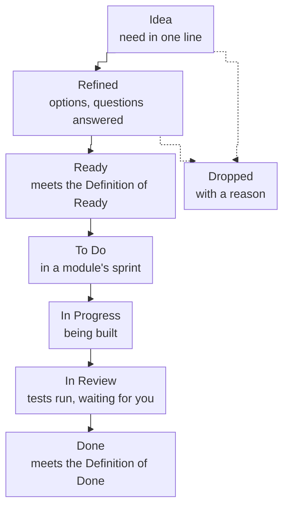

# 22 Product Backlog

Back to [[00 Project Home]] · Phase: Plan, scope · Owned by M0 – Project Management ([[02 Working Agreement]] §4) · Vision in [[10 Product Vision]] · Scheduled work in [[21 Roadmap]]

> [!abstract] What this is
> Every feature the product could get, grouped by the capability it serves ([[10 Product Vision]] §4.2). An item enters the backlog, gets refined, and moves into a module only when M0 schedules it. Nothing here commits the project to building anything ([[03 Decision Log]] D-072).
>
> **Since 2026-10-12 the items live in Jira** (D-104): project Second Brain, key KAN, holds each item's status, priority, capability, milestone and module. This document keeps the rules (§1) and the detail (§3), and lists the items by key (§2).

## 1. How items move

The names are Jira's statuses (§1.3).
- **Idea:** captured as said, with the need in one line.
- **Refined:** scope, options, dependencies and open questions written, and the questions answered.
- **Ready:** meets the Definition of Ready (§1.1).
- **To Do:** M0 schedules it: a milestone, a module and the owning thread, in [[21 Roadmap]] and in that module's sprint.
- **In Progress:** the module thread is building it.
- **In Review:** built and tested, waiting for your acceptance.
- **Done:** meets the Definition of Done ([[02 Working Agreement]] §6), on your word.
- **Dropped:** with a line saying why, on your word. Items are never deleted.
- **On hold:** at your request, at any status. The item keeps its status, is flagged, and stays out of scoping until you reopen it.

IDs never change. B-001 to B-038 are KAN-1 to KAN-38, and E-01 to E-09 are KAN-39 to KAN-47. A new item is created in Jira and known by its key, from **KAN-48**; a new capability is an epic named E-10 onward (D-105).

### 1.1 Definition of Ready
- [ ] The need is one sentence from your side, tied to a need or goal in [[10 Product Vision]] §2.
- [ ] Scope, options and open questions are written, and the questions answered.
- [ ] It fits in one module.
- [ ] "Done when" is written as acceptance criteria you'd accept; they become user stories in [[20 Product Requirements]] §3.1.
- [ ] Dependencies are named, and none blocks it.
- [ ] The owning thread is named.
- [ ] It passes the data boundary (D-018).

### 1.2 Types and priority
- **Types:** *Feature* (new behaviour), *Content* (sources or pages in the vault), *Chore* (a fix or tidy-up with no new behaviour), *Doc* (a project document).
- **Priority:** set when a milestone is scoped, with MoSCoW (Must, Should, Could, Won't this time). Ties go to the item that moves the North Star most for the least effort ([[10 Product Vision]] §3). Both are kept in Jira (§1.3).

### 1.3 In Jira
Project **Second Brain**, key **KAN**, on your personal Atlassian site (D-104). Jira holds each item's status, priority, capability, milestone and module. This document holds the rules and the detail. Threads read this document through project knowledge; Jira is not in project knowledge, so a rule written only in Jira reaches no thread.

| Here | In Jira |
|---|---|
| Capability E-nn | Epic, named "E-nn · name" |
| Feature B-nnn | Work item named "B-nnn · title", under its epic: a Feature for Feature and Content items, a Task for Chore and Doc items |
| Type | Label: `feature`, `content`, `chore` or `doc` |
| Milestone | Release: MVP 2, MVP 3, MVP 4. Labels `later` and `showcase-gate` for the rest |
| Priority (MoSCoW) | Priority: Must is Highest, Should High, Could Medium, Won't this time Low; Lowest until scored |
| Module | Sprint, named after its thread, such as "M8 – Research and Import" |
| Status (§1) | Status: Idea, Refined, Ready, To Do, In Progress, In Review, Done, Dropped |
| On hold | Flag, with the label `on-hold` |
| Detail (§3) | The description gives the need, depends-on, owner and decisions, and points here |

**Who moves what**
- **M0** creates items, refines them to Ready, sets priority and milestone, and schedules them into a module's sprint.
- **The module thread** moves its sprint's items to In Progress when work starts, and to In Review when the tests have run.
- **You** accept. An item goes to Done or Dropped only on your word; Claude makes the move when you say so.
- Vault sessions don't connect to Jira (D-036); the connector is used from this Project's threads.
- Jira holds titles, needs and pointers, nothing from `raw/` or `mine/` beyond that, and nothing from work (D-018).

## 2. Backlog by capability
Each item's status, priority, milestone and module are in Jira (§1.3); the key is in the second column, and the last column lists the decisions that shaped or delivered it. Milestones: **MVP 2** Research assistant, scope set by D-084 · **MVP 3** Work assistant · **MVP 4** Work-ready · **Later** · **Gate**: scheduled when you choose a showcase moment after an MVP (D-082) ([[10 Product Vision]] §4.1).

### E-01 · Capture · KAN-39
Gets material in: web clips, files, Claude outputs. Needs N1, N2.

| ID | Key | Item | Type | Depends on | Owner | Decisions |
|---|---|---|---|---|---|---|
| B-001 | KAN-1 | Office documents as sources (§3) | Feature | Doc 36, for work files (D-018) | M3, M1 | — |
| B-002 | KAN-2 | Mermaid support (§3) | Feature | — | M3 or M4 | — |
| B-004 | KAN-4 | Research a topic: Claude researches a new topic and returns a summary in which every fact names its source, plus the primary sources for you to clip (D-075, D-083) | Feature | B-003 | M8 (D-084) | D-095 to D-097 |
| B-005 | KAN-5 | Phone capture and sync | Feature | — | M1 | — |
| B-037 | KAN-37 | `/import` (§3): before ingest, checks new files against `raw/` for duplicates and newer versions, and recommends what to do (D-083) | Feature | Doc 31 §3, superseded claims | M8 (D-084) | D-099, D-101 |

### E-02 · Compile and verify · KAN-40
Turns sources into cited pages, with status, conflicts and trust. Needs N1, N3.

| ID | Key | Item | Type | Depends on | Owner | Decisions |
|---|---|---|---|---|---|---|
| B-003 | KAN-3 | Claude outputs as sources (§3) | Feature | Rule in doc 31 §2.2 | M8 (D-084), with small edits in what M2, M4, M5 and M7 own; rule by M0 | D-075, D-096, D-098 |
| B-006 | KAN-6 | Ingest a set: several sources on one topic in one run, with one review | Feature | D-022 revised | M7 (D-084) | D-085, D-086 |
| B-007 | KAN-7 | Trust levels: one per source (for example primary, secondary, commentary, AI); a fact takes the level of its best source; shown on pages and in `/ask` | Feature | Rule in doc 31 §2 | M7; rule by M0 | D-087 |
| B-008 | KAN-8 | Conflict resolution: Claude proposes one by trust and date, you decide, and the other claim stays visible | Feature | B-007; doc 31 §3 revised | M7; rule by M0 | D-088, D-094 |
| B-009 | KAN-9 | First domain set: the UK financial system and its legal framework | Content | The test set for B-006 | You, with M7 | — |
| B-038 | KAN-38 | Large documents (§3): a 1,000-page book or a full Act compiled in parts across sessions, with progress tracked | Feature | B-006 | M9 | D-107 to D-113 |

### E-03 · Ask and reuse · KAN-41
Answers from your own sources, and keeps the good ones. Needs N2, N3.

| ID | Key | Item | Type | Depends on | Owner | Decisions |
|---|---|---|---|---|---|---|
| B-010 | KAN-10 | Local Markdown search, once `index.md` stops scaling | Feature | — | M4 | — |
| — | KAN-48 | `ask`: report the wiki's own state correctly, and one path when no page covers the subject (MVP 2 regression, tests 3 and 6) | Chore | — | M4 | D-117 |

### E-04 · Keep healthy · KAN-42
Finds what's wrong or stale before you rely on it. Need N3.

| ID | Key | Item | Type | Depends on | Owner | Decisions |
|---|---|---|---|---|---|---|
| B-011 | KAN-11 | Page names in `log.md`, so `/drafts` can say which operation changed a page | Chore | — | M7 | D-091 |
| B-012 | KAN-12 | Re-read check for decision pages | Feature | B-016 | M6 | — |
| B-013 | KAN-13 | A hook that enforces page status | Feature | — | M2, M5 | — |
| B-014 | KAN-14 | A scheduled weekly digest | Feature | — | M5 | — |

### E-05 · Think · KAN-43
Holds your own conclusions and decisions. Goal: learn faster.

| ID | Key | Item | Type | Depends on | Owner | Decisions |
|---|---|---|---|---|---|---|
| B-015 | KAN-15 | The five Claude-written insights: rewrite, keep or archive (D-068) | Chore | — | You, with M6 | — |
| B-016 | KAN-16 | The first decision page, and a routine for decisions | Feature | — | M6 | — |

### E-06 · Jobs and standards · KAN-44
Produces work outputs to your standards. Need N4.

| ID | Key | Item | Type | Depends on | Owner | Decisions |
|---|---|---|---|---|---|---|
| B-017 | KAN-17 | Standards library: content, inputs, template, diagram style and audience for each output, as files in the vault, specified in doc 35 | Feature | — | New module | — |
| B-018 | KAN-18 | PRD job | Feature | B-017 | New module | — |
| B-019 | KAN-19 | Stakeholder brief job | Feature | B-017 | New module | — |
| B-020 | KAN-20 | Meeting notes to decisions job | Feature | B-017; doc 36 for work notes | New module | — |
| B-021 | KAN-21 | Prioritisation reasoning job | Feature | B-017 | New module | — |

### E-07 · Control and safety · KAN-45
Nothing changes without your say, and confidential material stays out. Need N5.

| ID | Key | Item | Type | Depends on | Owner | Decisions |
|---|---|---|---|---|---|---|
| B-022 | KAN-22 | Data governance (doc 36), with the bank AI-tools policy (Q-004) | Doc | — | M0 | — |
| B-023 | KAN-23 | Settle Q-015: claude.ai skills that sync into vault sessions | Chore | — | M2 | — |
| — | KAN-49 | `CLAUDE.md`: no offer to delete "as an exception to the rule" (MVP 2 regression, test 10) | Chore | — | M2 | D-117 |

### E-08 · Operate · KAN-46
Keeps running with little effort, and changes safely. Needs N1, N5.

| ID | Key | Item | Type | Depends on | Owner | Decisions |
|---|---|---|---|---|---|---|
| B-024 | KAN-24 | One move command for a whole set into `raw/`; the deny rule stays (D-045) | Feature | B-006 | M7 | D-089 |
| B-025 | KAN-25 | Claude commits after your review, with your approval per command; the push stays yours | Feature | D-008 revised | M7, with M2's settings | D-090 |
| B-026 | KAN-26 | Project docs written straight into the vault through the desktop link, instead of files you copy | Feature | D-028 revised | M0 | — |
| B-027 | KAN-27 | Skills no longer mirrored in doc 40; it links to the skill files instead | Chore | Your view on the mirrors ([[87 MVP Retrospective]] §3.1) | M2 to M6 | — |

### E-09 · Showcase and documentation · KAN-47
Shows the product and how it was built. Goal: show the work (D-079), when you decide an MVP is the showcase moment (D-082).

| ID | Key | Item | Type | Depends on | Owner | Decisions |
|---|---|---|---|---|---|---|
| B-028 | KAN-28 | Case study (doc 01): problem, your role, approach, key decisions, results, lessons | Doc | — | M0 | — |
| B-029 | KAN-29 | Public repository: a cleaned copy with a README and a licence. Keeps the system files and project docs; leaves out `raw/` (others' copyright), your notes in `mine/` and anything personal | Feature | D-018 check of every file | M0, M1 | — |
| B-030 | KAN-30 | Demo: screenshots and a short walkthrough of one ingest and one `/ask` | Doc | — | M0 | — |
| B-031 | KAN-31 | Success metrics (doc 12): definitions, baselines and targets per milestone | Doc | — | M0 | — |
| B-032 | KAN-32 | Market and alternatives (doc 13): what else solves N1–N4, and why this one | Doc | Research | M0 | — |
| B-033 | KAN-33 | Risk register (doc 04), gathering the risks now spread across doc 11 §10 and the handovers | Doc | — | M0 | — |
| B-034 | KAN-34 | Test strategy and traceability (doc 50): user stories to tests to results | Doc | — | M0, with M4 to M6 | — |
| B-035 | KAN-35 | Release notes (doc 60), starting with MVP 1 | Doc | — | M0 | — |
| B-036 | KAN-36 | Operations runbook (doc 71): routines, deploy, backup, restore and rollback | Doc | — | M0 | — |

## 3. Item details
Items with more than a one-line need. Others get a section here when they are refined.

### B-001 · Office documents as sources
**Need:** much product-owner material comes as Word, Excel and PowerPoint files, and `ingest` stops on them today.
**Raised:** 2026-09-25, M0, after reviewing which formats `raw/` supports.
**Today:** `raw/` takes Markdown and PDF. Claude Code's file reader doesn't open Office files, and the `ingest` ground rules forbid saving a converted copy, because that copy would be Claude's rendering rather than the source ([[40 Claude Operating Instructions]] §4.1). So you convert by hand first.
**Options to weigh when refining:**
- **a. You save as PDF before capture.** Nothing to build, and page citations already work (D-046). Spreadsheet structure is lost.
- **b. A converter you run, not Claude, produces Markdown.** The original and the converted text both go into `raw/`, with a rule saying which one citations point at.
- **c. Claude reads Office files through an installed tool.** Needs your install (D-054), plus a citation form for a slide, a sheet or a cell.

**Open questions:** which of the three formats matter most; how a citation points into a slide or a cell.
**Constraint:** until doc 36 exists, only personal and public Office files qualify (D-018). Work files are most of the reason for this item, so its full value waits on doc 36.

### B-002 · Mermaid support
**Need:** diagrams as part of the knowledge base.
**Raised:** 2026-09-25, M0.
**Two readings, scope to confirm:**
- **Input: Mermaid scripts as sources.** A Mermaid block inside a Markdown source is already readable text. A standalone `.mmd` file is plain text too, but untested and not in the blueprint's list for `raw/` ([[32 Vault Blueprint]] §1).
- **Output: Claude draws Mermaid diagrams in wiki pages,** such as the overview, analyses or concept maps. Obsidian renders them without a plugin.

**Design question for the output reading:** a diagram is a set of claims, one per arrow. The provenance rule (D-021) needs a line for it; for example, a diagram only restates claims cited on the same page, and `lint` checks it like any other claim.
**Open question:** input, output, or both.
**On hold:** 2026-09-25, at your request. Out of MVP 2 scoping until you reopen it. The format is settled meanwhile: any diagram is Mermaid (D-073).

### B-003 · Claude outputs as sources
**Need:** save a Claude output (a chat answer, a research report, an artifact) into the vault as material the wiki can use, so nothing useful disappears into chat history ([[11 Project Charter]] §1).
**Raised:** 2026-09-26, M0, while planning how to learn the UK financial system with Claude as the main research tool.
**Why a rule is needed:** saved and ingested as it is, a Claude output would be cited like any other source, and pages could turn `verified` on Claude's say-so: the circular evidence [[31 Trust and Provenance]] exists to prevent. Yet a summary can be true even when it names no source.
**Direction:** option c, both ways, decided 2026-09-27 ([[03 Decision Log]] D-075).
- **Map (works today):** the output is kept in `mine/projects/<topic>/`, already named `claude-<YYYY-MM-DD>-<topic>.md` with `origin: claude`, `source-type: ai` and its chat link, so it can move straight into `inbox/sources/` once the source path is built. Meanwhile only the primary sources it cites are ingested. Not `inbox/sources/`, where `/ingest` would treat it as an ordinary source, and not `mine/scratch/`, which the weekly review empties.
- **Source (to build):** the output is saved into `inbox/sources/` and run through `/ingest` like any source, verified claim by claim.

**Design for the source path**
1. **Mark it.** File named `claude-<YYYY-MM-DD>-<topic>.md`, with `source-type: ai` and the chat link in its properties. `/ingest` asks when a file reads like AI output but carries no mark.
2. **Verify each claim** at ingest, before anything is written:
   - Found in `raw/` → cites that raw file, not the Claude output.
   - Not in `raw/` → Claude searches the web for the primary source and adds it to a capture list for the user to clip. The web page itself is never evidence, and nothing is fetched into the zone (D-043).
   - Contradicted by `raw/` → left out of the wiki and reported in the brief.
   - Still unbacked → kept, citing the Claude output, labelled "(AI)".
3. **Status.** An "(AI)" claim counts as uncited, so its page is `unverified` and shows in Needs attention. No new status.
4. **Upgrade.** When a source from the capture list is ingested, `/ingest` re-cites the matching "(AI)" claims to it and drops the label.
5. **Checks.** `/lint` lists every "(AI)" claim still waiting for a primary source; `/ask` names them under Caveats.

**Owners when built:** the rule in doc 31 (M0); `CLAUDE.md` and `system/conventions.md` (M2); `ingest` (M3); `ask` (M4); `lint` (M5).
**To settle in the building thread:** where the capture list lives between sessions (for example, lines in `inbox/checks.md`); whether web search needs an allow rule, since manual mode asks before each search; a size limit for long research reports.
**Settled in M8 (accepted 2026-10-06):**
- The capture list is one file, `system/research/capture.md` (D-097).
- Web search gets no allow rule. `/ingest` doesn't use the web at all: the sources an output names go on the capture list, and `/research` looks for the rest (D-096, which refines step 2 above).
- No size limit beyond one Claude output per set. A long one compiles section by section, with each section ticked in the set review (D-098).
- The label is `· AI`, as D-087 set it, where the design above says "(AI)".

**Constraint:** the output must pass the same data boundary as any source (D-018).

### B-004 · Research a topic
**Need:** Claude researches a new topic and gives back a summary I can check, with the sources to bring in.
**Raised:** 2026-09-30, M0, as part of the showcase bar (D-083).
**Built in M8 (accepted 2026-10-06):** the `research` skill (D-095). `/research <topic>` checks the wiki, searches the web, and writes a report in `system/research/` in which every fact names its source with a link and a quote. The sources to clip go on the capture list (D-097). With no topic it looks for sources for the wiki's `· AI` claims.
**Boundaries:** the report is level AI and changes nothing in the wiki; a fetched page is never saved (D-043). The web is reached only from this skill, with official sites pre-approved and any other site asking first (D-096).
**Limits per run:** 25 facts, 8 sources to clip, about 12 searches and 15 fetches.

### B-037 · `/import`: duplicates and versions
**Need:** every document you bring in is checked for duplicates, and gets a version recommendation when a similar document already exists with small changes, or when it carries clues of a version change.
**Raised:** 2026-09-30, M0, as part of the showcase bar (D-083).
**What it would do:** a new skill that runs on files in `inbox/sources/` before `/ingest`. For each file it reports one of:
- **Duplicate:** the same document is already in `raw/` → recommend not ingesting it.
- **New version:** a similar document is in `raw/` with small changes, or the file carries version clues (a date, a version number, "amended", "revised") → recommend ingesting it as a new version, so the claims it changes are marked superseded ([[31 Trust and Provenance]] §3).
- **New:** nothing similar → ready for `/ingest`.

**Settled in M8 (D-099, accepted 2026-10-06):**
- **Similar** is measured three ways, in order: the same origin (the clip's `source` URL), the same identity (title and publisher), the same text (three sampled passages).
- **A new version** takes the existing raw name's stem with its year, or year and month. Both files stay.
- **Both:** its own command, and the first step of the `/ingest` brief, which reads the same procedure.
- Two more verdicts: **older version** and **unsure**.

**Extended on 2026-10-06, at your request (D-101, accepted the same day):** `/import <links>` and `/import capture` load documents before the check. A PDF is downloaded byte for byte into `inbox/sources/`, in one command you approve. A web page is listed for you to clip, because no saved form of a page is both exact and readable in Obsidian. The constraint above now reads: the check writes nothing, and the load writes only the files you approve.
**Constraint:** writes nothing; it recommends, and you decide.

### B-038 · Large documents
**Need:** handle massive documents, such as a 1,000-page book or a full piece of legislation.
**Raised:** 2026-09-30, M0, when you accepted MVP 2's scope (D-084).
**Today:** `/ingest` reads a long PDF in page ranges, but compiles a whole source in one run and one session. A document this size is more than one session can read and write, and Pro usage is shared with claude.ai ([[11 Project Charter]] §9).
**Options to weigh when refining:**
- **a. Map first, then parts.** The first run reads the structure (contents, parts, chapters) and writes the source page as a map with a list of parts. Later runs compile one part or a few at a time, and the map records which are done. `/ask` says when an answer may sit in a part not yet compiled. The file stays whole in `raw/`, and citations point to its page or section.
- **b. You split the file before capture,** for example one file per Part of an Act. Simple, but citations point to parts and the whole-document view is lost.
- **c. Claude proposes a split plan and you run it,** so the parts become raw files under one parent source page.

Claude's lean: **a**, since it keeps `raw/` immutable and citations exact (D-042).
**Open questions:** the citation form for a section of a Markdown source (a heading link); where progress is recorded between sessions; how an amended Act is handled (with B-037's new versions); how much one session should take on.
**Test document:** the full FSMA 2000, which extends the Part 1A source already in the vault. Public legislation, so it can be kept and quoted.
**Settled in M9 (D-107 to D-113, accepted 2026-10-15):**
- **Option a.** A document over 150 PDF pages or 3,000 lines stays whole in `raw/`. Its first run writes its source page as a map: every part, where it sits, a plan and a status. Each later run, `/ingest part <document>`, compiles one part, with its own brief, set review, commit and source page (D-107). The procedure is `ingest/large-source.md`.
- **Progress** sits on the map between runs and in the set review within one, one row per chunk of up to 20 PDF pages, so a stopped run resumes at the next chunk (D-108).
- **One session:** one part, at most about 60 PDF pages or 2,000 lines; `/clear` between runs and `/lint` before the next part (D-108).
- **Capture:** the full Act as one PDF of the revised text, loaded by `/import` (D-109).
- **Overlaps and amendments:** `/import` gains the verdict **part**. The full Act and the Part 1A clip both stay, and Part 1A is compiled as a compare (D-110). A consolidated text is named with the year and month it is up to date to, and a later capture is a new version whose parts are compared when chosen (D-111).
- **Citation form:** a PDF page plus the section; in Markdown, a link to the heading plus the section (D-112).
- **Tests:** LD1–LD8 on the full Act (D-113).
**Built in M9 (closed 2026-10-20), tests 8 of 8:** the whole FSMA 2000 mapped (49 Parts, 36 Schedules) from its contents page, Parts II, 4A and XVI compiled and Part 1A compared, across four sessions, with one stop and resume. Every citation into the Act gives its page and section. Rules added at the close: D-116. KAN-38 is In Review; Done on your word.
- **A file with no contents pages,** such as the whole-Act PDF, is mapped from a clip of the publisher's contents page, the map's companion with no source page of its own (D-115, accepted 2026-10-17).
**Constraint:** a copyrighted book stays private in `raw/` and never goes into a public showcase (D-079).

### KAN-48 · `ask`: the wiki's own state, and the no-page path
**Need:** `/ask` reports the wiki's own state correctly, and has one output path when no page covers the subject but nearby pages exist.
**Raised:** 2026-10-20, M0, from MVP 2's regression, Run 7 (D-117). Blocks criterion 6.
**Found:**
- **Test 3, Partial.** `/ask Summarise where my reading has got to.` gave "21 sources", sixteen of them UK, where the overview says seventeen. The 21 is the "(N sources)" on the overview's line in `index.md`, the length of its `sources` property, which leaves out the Claude note by design. It also said no conflicts are open in either strand, while the knowledge-management strand has two open disputes on seven `contested` pages.
- **Test 6, Partial.** `/ask What does the wiki say about the Consumer Duty?` opened "No wiki page covers the Consumer Duty", not the exact "Nothing in the wiki on this.", and used headings of its own. No page covers the subject, but nearby pages exist, and the skill names only two cases: nothing, or the standard sections.
- **Minor.** Test 5: an `unverified` page's reason given as a line number, not the reason the page states; `/research` proposed for sources already open on the capture list, where `/import capture` loads them. Test 8: `file-answer` §5 doesn't say where the backlink goes when a source page is under Related, since source pages have no Related list; lint's check 6 expects one.
**Owner:** M4. **Done when:** the fix is in `ask` and `file-answer`, mirrored in [[40 Claude Operating Instructions]] §4; tests 3 and 6 rerun and pass, recorded as new rows in Run 7.
