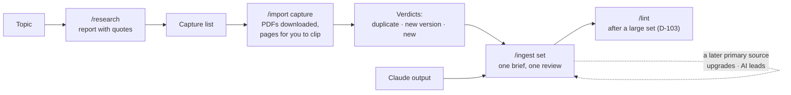

# 89 M8 Handover

Back to [[00 Project Home]] · Modules in [[21 Roadmap]] §2 · Previous: [[88 M7 Handover]]

**Module M8 – Research and Import · closed 2026-10-14. Tests IM1–IM6, RS1–RS4 and AI1–AI4: 14 of 14. Next: M9 – Large Documents.** This thread stays open to maintain the `research` and `import` skills, `ingest/ai-source.md` and the capture list (D-071).

## What was done
- **`/research`** (D-095, D-096). Give it a topic. It checks the vault, searches the web, reads official pages and writes a report in `system/research/`. Every fact in the report has a source number, a quote and where the quote sits. The sources come with their trust level, and the ones to clip go on the capture list. Nothing in `wiki/`, `raw/` or `inbox/` changes. It is the only operation that reaches the web. Searches and the listed official sites are granted inside the skill, so no allow rule was added to the settings. Shell routes to the web are denied, except `/import`'s download, which asks each time.
- **The capture list** (D-097). `system/research/capture.md`: one line per source to clip. `/research` and `/ingest` add lines; `/ingest` ticks a line, with its raw name, when the source is compiled.
- **`/import`** (D-099, D-101). It checks each file in `inbox/sources/` against `raw/` by origin, identity and text. Each file gets a verdict (duplicate, new version, older version, new or unsure) and a recommendation, and nothing is written. Given links, or `capture`, it first downloads the PDFs in one command you approve and lists the pages for you to clip. The `/ingest` brief runs the same check, so nothing enters twice even when you skip the command.
- **A Claude output as a source** (D-098). It goes through `/ingest` at level AI, following `ingest/ai-source.md`. Each statement gets one of four outcomes: backed by `raw/`, unbacked (kept as an `· AI` lead, page `unverified`), contradicted, or not a claim of fact. A later primary source upgrades an `· AI` lead by re-citing it.
- **The UK set grew** (B-009) from 7 sources to 16:
  - seven primary sources on the Financial Ombudsman Service, from the research report;
  - the Claude study note from M7;
  - the FCA's 115-page Final Notice to TSB Bank.



**For a new topic, your steps are four:**

1. Run `/research`.
2. Run `/import capture` and clip the pages it lists.
3. Run `/ingest`, then read one review and decide its conflicts.
4. Push.

## What the tests taught us, and what changed because of it
| What happened | What changed |
|---|---|
| IM2, first run: verdict, changes and raw name were right, but it didn't say the changed claim becomes a **newer** conflict | `import` step 4 says what ingesting a new version does. The rerun passed |
| RS1: one fetch asked for approval, most likely the bare `financial-ombudsman.org.uk`, which a `*.` rule doesn't cover | Each listed site's bare address is granted beside its subdomains |
| RS1: the S1 link was a `.pdf` address Claude built, and two Handbook links used a form that doesn't open. You found the real one, `/handbook/disp2/disp2s7` | `research` records each URL exactly as opened, after redirects, and writes "PDF download" only for a link that returned a PDF |
| RS1: the Result line said 25 facts; there were 26 lines | The count is the lines under Facts. The log entry gets a blank line before it |
| IM5: the one "PDF" was the Handbook's JavaScript home page. L4 flagged it, gave the `Remove-Item` line and tried nothing else | No change to `import`; the `research` fix stops the bad link at its source |
| RS3: Claude in Chrome can't press the Web Clipper, and legislation.gov.uk isn't open to it. Claude opened the checked pages for you instead | No change. Clipping stays your step |
| AI2: 108 statements: 28 backed, 67 `· AI`, 1 contradicted (the FCA's ~1,500 PRA firms against the PRA's ~1,292), 12 not claims of fact | No change. The contradicted claim sits in the set review only, as designed |
| AI2: the run kept the FSMA ss. 19, 23 and 55E–F leads on the Claude source page, so the FCA, PRA and Treasury pages stayed `verified`. It was a judgement call, and you were asked | D-102 writes the rule down |
| AI3: asked to mark TSB Bank `verified`, Claude declined and listed its 24 unsourced claims with the source that would back each | No change |
| IM6, AI4: the 115-page Final Notice was downloaded on one approval and compiled in one session. 20 TSB claims were re-cited to it by page and paragraph | No change. TSB Bank stays `unverified` on 5 PRA-side claims, which the Bank of England's release would back |
| Lint after M7's set found 6 high errors (report-2026-10-06). Lint after the Ombudsman set and the Claude output found 5 more (report-2026-10-14). The set reviews had passed every one | D-103: `/ingest` recommends `/lint` after a large set |
| `index.md` showed Windows line endings after a lint apply. You restored it with `git checkout` | No change. Watch for a repeat (Risks) |
| Twice a skill used a read-only shell command against its ground rules: lint counting files, and ingest reading `log.md` with `tail`. Both were harmless and reported | Parked for M0 |
| A run suggested the synced `/deep-research` skill instead of `/research` | Parked (B-023) |

## Decisions made in M8
- **D-095:** `/research` writes a cited summary and lists the sources to clip.
- **D-096:** the web is searched and read only from `/research`.
- **D-097:** the capture list.
- **D-098:** a Claude output goes through `/ingest` as an AI source.
- **D-099:** `/import` is its own command and the first step of the `/ingest` brief.
- **D-100:** M8's test set and tests.
- **D-101:** `/import` loads links: it downloads files and leaves pages to you. This revises D-043 for files.
- **D-102:** where an unbacked AI claim goes: on a page only when it is about that page's subject.
- **D-103:** lint after a large set: `/ingest` recommends it.

All accepted: D-095 to D-101 on 2026-10-06, D-102 and D-103 at the close on 2026-10-14.

## State of the vault
- **`raw/`:** 21 sources:
  - 5 on knowledge systems;
  - 7 on UK regulation from M7;
  - 7 on the Financial Ombudsman Service;
  - 1 Claude output;
  - the FCA's Final Notice to TSB.
- **`wiki/`:** 78 pages: 21 source pages, 17 entities, 38 concepts, 1 analysis and the overview.
  - About 62 are `verified` and 7 `contested` (unchanged from MVP 1).
  - 9 are `unverified`: Karpathy, Solo and dual regulation, Payment Systems Regulator, Monetary Policy Committee, Operational resilience, TSB Bank, Financial Services and Markets Bill 2026–27, Source - Claude on who regulates what (2026-09-27) and Principles for Businesses.
- **`system/ingest/`:** 5 set reviews, three of them from M8:
  - `set-2026-10-14`: 7 sources, 2 conflicts, resolved 1a 2a;
  - `set-2026-10-14-2`: the Claude output;
  - `set-2026-10-14-3`: the Final Notice.
- **`system/lint/`:** 4 reports, the last `report-2026-10-14` with all 7 findings applied.
- **`system/research/`:** 1 report, and the capture list with 10 open lines:
  - FSMA s. 228, and the full FSMA contents;
  - the Bank of England's TSB release;
  - two Parliament pages on the Bill;
  - PRIN and the PRA Rulebook, and the State Bank of Vietnam;
  - the Lords Library briefing (secondary), Bratby and Linklaters (commentary).
- **`mine/drafts/`:** 11 drafts, none checked. **`mine/insights/`:** 5, unchanged.
- **Skills:**
  - `ingest` (with `ai-source.md`), `import` and `research`;
  - `ask`, `file-answer`, `lint` and `drafts`.
- **Settings:** 9 allow, 3 ask and 13 deny rules.
- **`log.md`:** the last entry is the ingest of the Final Notice.
- **Branch `main`:** 12 commits in M8, the last 43c4c52 (`set-2026-10-14-3`), all pushed before the closing files.
- **The Claude note mentions two files the vault doesn't hold,** a "principal file" and a "live issues register", which AI2 flagged. Nothing points at them.
- **Your file, `system/context.md`:** "Current focus" says M8. Change it when M9 opens.

## MVP 2 status ([[11 Project Charter]] §11)
| Criterion | Status |
|---|---|
| 1. Research: a summary in which every fact names its source, plus sources to clip | **Met** (RS1–RS4, 2026-10-14) |
| 2. Import: `/import` flags a planted duplicate and a planted new version | **Met** (IM1–IM4, 2026-10-12) |
| 3. Batch ingest: 5 or more sources in one run with one review, conflicts first, facts by trust | **Met** in M7. Repeated in RS3 with seven sources |
| 4. Large documents compiled in parts, with progress tracked | M9 |
| 5. Side-by-side: 5 questions through `/ask` and a default Claude chat | At MVP 2's exit. In RS3, `/ask` traced every fact to `raw/` with its level and labelled the gaps as general knowledge |
| 6. Regression: the 21 MVP 1 tests still pass | At MVP 2's exit. `ingest`, `ask` and `lint` changed again in M8, so all 21 are rerun |

## What M9 must produce
From [[21 Roadmap]] §2 and [[22 Product Backlog]] B-038: **a document of several hundred pages, such as the full FSMA 2000, compiled in parts across sessions.** Progress is tracked between sessions, and every citation points to its page or section. M9 is the last build module of MVP 2. Criteria 5 and 6 then run at the exit.

**What M8 leaves ready for it**
- **The full Act is on the capture list** (the FSMA contents line). Compiling it backs the leads AI2 kept on the Claude source page: FSMA ss. 19, 23 and 55E–F. Under D-102 they can then move onto the FCA, PRA and Treasury pages with primary citations. FSMA s. 228, from the research report, is also open.
- **`/import` will meet an overlap.** `raw/` already holds FSMA Part 1A. The full Act has the same publisher and title but is a larger document, so expect "unsure" or "new". M9 decides how the two files relate.
- **Citations into a long PDF work.** The Final Notice is cited by page and paragraph (`#page=14`, para 4.4) across 115 pages, in one session.
- **The resume path is still untested** (D-086). M9 is where a run will stop part-way.

**To settle in M9:**
- How to capture the full Act: one clip, one PDF, or one file per Part.
- The citation form for a section of a Markdown source.
- Where progress sits between sessions, which is option a of B-038, Claude's lean.
- How an amended Act is handled with `/import`'s new versions.
- How much one session takes on within the Pro allowance.

**Opening brief for the M9 thread**
```
Module: M9 – Large Documents
Goal: a 1,000-page book or a full Act can be compiled (21 Roadmap §2)
Handover: 89 M8 Handover
Read first: 11 §11; 21 §2; 22 item B-038; 31 §2.2; 40 §4.1 and §4.7; 03 D-042, D-086, D-099, D-102
Time available this week:
```

## Request for M0
```
M0 · Project Management · request from M8
What: bring the as-built descriptions up to date with research, import and AI sources:
  10 §2.2 (N1) and §4.2 (E-01, E-02), 11 §11 (criteria 1 and 2 met; the risk row says "(AI)", the marker is "· AI"),
  20 §1.7, §2.1, §3.1 (US-01), §5 (/research and /import as functions), §6.4 (9 allow, 3 ask, 13 deny) and §6.6 (the web boundary), 30 §4 and §5.
  In 02 §4, M8's row: the research and import skills (40 §4.6–4.7), ingest/ai-source.md, system/research/ and the capture list, tests IM, RS and AI.
  Decide whether skills may run read-only shell commands (counting files, reading the end of log.md), or keep to Glob, Grep and Read.
Why: D-095 to D-103; M8 closed 2026-10-14
Read first: 89 M8 Handover; 40 §4.6 and §4.7; 33 §7
Done when: docs 10, 11, 20 and 30 describe /research and /import as built, and 02 §4 matches who maintains what
```

## Parked in M8
- **Resuming a stopped set** (D-086): still untested. M9 will exercise it.
- **Synced claude.ai skills** (Q-015, B-023): they still load in vault sessions, and one run suggested `/deep-research`. Hiding them needs the names `/skills` lists.
- **Read-only shell:** for M0 (above).
- **Clipping by Claude:** Claude in Chrome can't press the Web Clipper, and computer use only reads browser windows. The FCA Handbook's "View as PDF" is a button with no link `/import` can use.
- **TSB Bank to `verified`:** clip the Bank of England's release, which is on the capture list, and ingest it. Its 5 PRA-side `· AI` claims would then be cited.
- **Eleven drafts wait for `/drafts`.**
- **Still parked from earlier modules:** a weekly reminder; the sources lint suggested in M5; `Claude outputs/` at the vault root.

## Risks to watch in M9
- **A run stops part-way.** A full Act is more than one session. The resume path has never run, so the first stop is its test. Check that the next run picks up at the right part and doesn't compile a part twice.
- **A long review read too fast.** The set review samples one claim per level, and lint keeps finding what it misses. After each part of the Act, run `/lint` (D-103).
- **Leads move without a source.** When the Act backs an FSMA lead, the `· AI` marker must go only where a section states the claim. Check a few against the section before accepting.
- **Line endings.** If Git warns again that a vault file has Windows line endings, note which operation wrote it. Every vault file is meant to change through Edit or Write only.
- **The Pro allowance.** The largest source so far, the 115-page notice, fitted in one session; a full Act is several times that. Plan M9's parts so that each ends cleanly.
