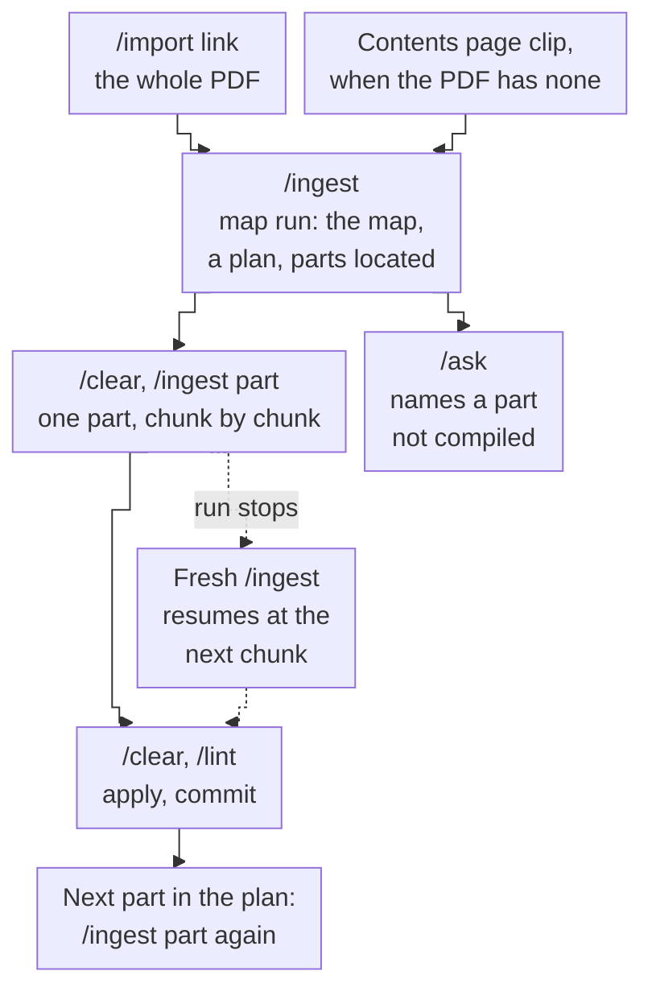

# 90 M9 Handover

Back to [[00 Project Home]] · Modules in [[21 Roadmap]] §2 · Previous: [[89 M8 Handover]]

**Module M9 – Large Documents · closed 2026-10-20. Tests LD1–LD8: 8 of 8. M9 was the last build module of MVP 2. Next: MVP 2's exit tests, criteria 5 and 6, then the retrospective and the showcase gate, all scheduled by M0.** This thread stays open to maintain `ingest/large-source.md`, the FSMA map and its part pages, and the tests LD1–LD8 (D-071).

## What was done
- **A large document stays whole in `raw/`** (D-107, D-108). Its first run writes its source page as a **map**: every part, where it sits in the file, a numbered plan and a status. Each later run, `/ingest part <document>`, compiles one part, with its own brief, set review, commit and source page. Progress sits on the map between runs and in the set review within a run, chunk by chunk.
- **A PDF without contents pages is mapped from the publisher's contents page** (D-115). legislation.gov.uk's whole-Act PDF opens on the text, so a clip of the Act's contents page joins the map run as its *contents companion*. It has no source page of its own and never ticks a capture line.
- **Overlaps and versions** (D-110, D-111). `/import` gained the verdict **part**. The full Act and the Part 1A clip both stay, and Part 1A was compiled as a **compare**. A consolidated text is named with the year and month it is up to date to.
- **Citations carry their place** (D-112): a PDF page plus the section, or a heading link in Markdown.
- **The test document:** FSMA 2000 as revised, 1,263 pages, up to date to 10 September 2026 (D-109).
  - Mapped with 49 Parts and 36 Schedules.
  - Compiled: Part II (the perimeter), Part 4A (permission) and Part XVI (the ombudsman scheme).
  - Part 1A compared against the clip.
  - Four sessions in all, with `/lint` after each part.



**For a large document, your steps are five:**
1. Run `/import <link>`, or save the PDF into `inbox/sources/`. If it has no contents pages, clip the publisher's contents page too.
2. Run `/ingest`, read the brief, paste the move block and reply. The map is written.
3. Run `/clear`, then `/ingest part <document>`, and reply to the part's brief.
4. Read the set review and commit. Then `/clear`, `/lint`, apply what it finds, and commit.
5. Repeat steps 3 and 4 for each planned part. If a run stops, a fresh `/ingest` resumes it.

## What the tests taught us, and what changed because of it
| What happened | What changed |
|---|---|
| LD2, first run: the whole-Act PDF has no contents pages. The brief named the parts it couldn't locate from general knowledge, labelled, and asked | D-115: the map takes its parts from a clip of the contents page |
| LD2, second run: it ran on the old skills, because the batch with the skill files hadn't been deployed | No change. Each batch's `_DEPLOY.md` now opens with the line that unzips the skill files |
| Before the map run, the move block was pasted but the reply never came. The Act sat in `raw/` with no set review, and `/ingest` saw an empty zone | You moved it back by hand. Parked (below) |
| LD3: the run recorded your emphasis on the map and counted "N of M planned parts" | Both written into `large-source.md` (7bcc45f) |
| Lint after the map and Part II: the compare link was missing from the map's `sources`, and pages the map links didn't link back | Both written into `large-source.md` (7bcc45f) |
| LD5: the stop fell after chunk 1a's pages were written and before its tick. The resume read the pages, recorded what was there, and finished. Nothing was added twice | A chunk is marked `started` before it is written (7bcc45f; D-116) |
| Lint after Part 4A: a claim on a `verified` page cited the Part II source page, a wiki page as evidence | D-116: a claim leaning on another part cites `raw/` at that part's page and section |
| Lint after Part XVI: two high findings, wording stronger than the Act ("binds neither party"; "FCA rules make firms pay") | No change: `/lint` after every part stays (D-108). It caught 0, 1, 2 and 0 high errors across the four parts that the runs had passed |
| The compare: every cited passage reads the same, but the clip lost text the PDF holds (the s. 1H(8) definitions, some section numbers) | D-116: a compare adds no claims; a claim a page lacks comes from the later file where it holds the passage, otherwise from the file that does |
| Shell use in five runs: `grep` for links, `wc -l`, `git show` to read the end of `log.md`. All harmless and reported. D-106's file-tool forms had never been added to `CLAUDE.md` | `ingest` names what git it may run (7bcc45f); `CLAUDE.md` gains D-106's two lines (this batch) |
| The Part 4A brief proposed settling an Act-against-MoU difference by "higher level", but both are primary | Corrected in the reply; the rule in `ingest` A4.3 already says it. No change |
| LD8: `/ask` on Part XXV named the uncompiled part and the command, and labelled general knowledge | No change |

## Decisions made in M9
- **D-107:** large documents stay whole in `raw/`, are mapped first, and are compiled one part per run.
- **D-108:** progress on the map and in the set review; one part of about 60 pages per run; `/clear` between runs and `/lint` after each part.
- **D-109:** the full FSMA as one PDF of the revised Act, loaded by `/import`.
- **D-110:** the `/import` verdict **part**, and the compare.
- **D-111:** an amended Act is a new version, dated by its "up to date" line.
- **D-112:** citations carry their place.
- **D-113:** M9's test document and tests.
- **D-115:** a PDF without contents pages is mapped from the publisher's contents page.
- **D-116:** the closing rules, which cover a claim leaning on another part, a compare adding no claims, a chunk marked `started`, and prospective text.

D-107 to D-113 were accepted on 2026-10-15, D-115 on 2026-10-17 and D-116 at the close on 2026-10-20. D-114, the staging rule, came from M0 during M9.

## State of the vault
- **`raw/`:** 23 sources, the 21 from M8 plus:
  - `uk-parliament-fsma-2000-2026-09.pdf`, the whole Act;
  - `uk-parliament-fsma-2000-contents-2026-10.md`, its contents page.
- **`wiki/`:** 85 pages: 25 source pages, 17 entities, 41 concepts, 1 analysis and the overview.
  - **New in M9:**
    - the map, `Source - FSMA 2000 (2026-09)`;
    - the part pages for Part II, Part 4A and Part XVI;
    - the concept pages General prohibition, Financial promotion and Part 4A permission.
  - **Status:** 69 `verified`, 7 `contested` (the MVP 1 disputes, unchanged), and 9 `unverified`:
    - Solo and dual regulation;
    - Operational resilience;
    - Principles for Businesses;
    - Source - Claude on who regulates what (2026-09-27);
    - Payment Systems Regulator;
    - TSB Bank;
    - Monetary Policy Committee;
    - Karpathy;
    - Financial Services and Markets Bill 2026–27.
- **The FSMA map:** 3 of 8 planned parts compiled (II, 4A, XVI), and Part 1A compared. Plan items 5 to 8 are open: Schedule 6, Parts XV–15A, Part 9B and Schedule 2. Every other part is `not compiled`.
- **`system/ingest/`:** 10 set reviews, five of them from M9: the map, Part II, Part 4A, Part XVI and the compare. All are `done`. Part 4A's conflict was resolved as 1c.
- **`system/lint/`:** 8 reports, four of them from M9, all applied.
- **`system/research/capture.md`:** 8 open lines, none of them FSMA. Lines 8 (s. 228) and 16 (ss. 19, 23, 55E–55F) were ticked in M9. The open lines are:
  - the Bank of England's TSB release;
  - five on the Financial Services and Markets Bill;
  - PRIN and the PRA Rulebook;
  - the State Bank of Vietnam.
- **`mine/drafts/`:** 14 drafts, none checked; three are from M9. **`mine/insights/`:** 5, unchanged.
- **Skills:**
  - `ingest`, with `ai-source.md` and `large-source.md`;
  - `import` and `research`;
  - `ask`, `file-answer`, `lint` and `drafts`.
- **Settings:** unchanged: 9 allow, 3 ask and 13 deny rules.
- **Branch `main`:** 12 commits in M9, from 1df0f61 to c81ef14, all pushed before the closing files.
- **Jira:** KAN-38 is In Review.
- **Your file, `system/context.md`:** "Current focus" says M9. Change it when the exit tests start.

## MVP 2 status ([[11 Project Charter]] §11)
| Criterion | Status |
|---|---|
| 1. Research: a summary in which every fact names its source, plus sources to clip | **Met** (RS1–RS4, 2026-10-14) |
| 2. Import: `/import` flags a planted duplicate and a planted new version | **Met** (IM1–IM4, 2026-10-12) |
| 3. Batch ingest: 5 or more sources in one run with one review | **Met** in M7 (2026-10-06) |
| 4. Large documents compiled in parts, with progress tracked and every citation pointing to its page or section | **Met** (LD3–LD6, 2026-10-20) |
| 5. Side-by-side: 5 questions through `/ask` and a default Claude chat | At the exit |
| 6. Regression: the 21 MVP 1 tests still pass | At the exit. `ingest`, `import` and `ask` changed again in M9, so all 21 are rerun |

## What the exit needs
No build module is left in MVP 2. The exit runs the two criteria left ([[21 Roadmap]] §2, D-083):
- **Criterion 5, side-by-side:** 5 questions on the UK set, through `/ask` and in a default Claude chat. Every fact in the `/ask` answers traces to `raw/` with its trust level.
  - The set now includes the Act's perimeter, permission and ombudsman rules.
  - Pick questions the compiled pages cover. A question in an uncompiled part tests LD8's behaviour, not the fact guarantee.
- **Criterion 6, regression:** the 21 MVP 1 tests, rerun.
- **Then** the retrospective and the showcase gate (D-082).

## Request for M0
```
M0 · Project Management · request from M9
What: bring the as-built descriptions up to date with large documents, and schedule MVP 2's exit:
  10 §4.2 (E-02: large documents), 11 §11 (criterion 4 met 2026-10-20; the usage-limits risk row: the resume path ran in LD5),
  20 (/ingest part as a function, a user story for large documents), 30 §4–5, 31 §1 (citations into parts, D-112),
  32 §1 and §7 (naming: consolidated legislation, the contents companion), 33 §2 (the contents companion joins the map run).
  In 02 §4, M9's row: ingest/large-source.md, the FSMA map and part pages, tests LD1–LD8; closed 2026-10-20.
  Jira: KAN-38 is In Review; Done on your word; close the M9 sprint.
  D-116 is accepted. CLAUDE.md gained D-106's two lines in M9's closing batch, for M2's record.
  Schedule criteria 5 and 6, then the retrospective and the showcase gate.
Why: D-107 to D-116; M9 closed 2026-10-20
Read first: 90 M9 Handover; 40 §4.1 (large-source.md); 11 §11
Done when: docs 10, 11, 20 and 30–33 describe large documents as built, 02 §4 matches who maintains what, and the exit tests have a thread and a date
```

## Parked in M9
- **Files moved into `raw/` with no set review.** If a session ends between the move block and your reply, the files sit in `raw/`, no set review knows them, and `/ingest` sees an empty zone. Seen once, before the map run. A0 could look for raw files that no source page names.
- **Fourteen drafts wait for `/drafts`.** One still says an ombudsman decision "binds only if accepted", the reading lint removed from the wiki.
- **The FSMA plan, items 5–8:** Schedule 6, Parts XV–15A, Part 9B and Schedule 2. This thread compiles them when you ask, with `/lint` after each.
- **s. 3B(1)(c):** which text applies needs the commencement orders S.I. 2023/779 and S.I. 2023/1382, which aren't in `raw/`. `/research` can find them.
- **The ombudsman reading:** Schedule 17 and DISP 3.6 would settle who runs the scheme and what follows a rejected decision.
- **A newer Act PDF:** the one in `raw/` is up to date to 10 September; the site's text was later. A newer PDF comes in as a new version (D-111), and only the compiled parts are compared.
- **Usage:** `/usage` wasn't recorded per run, so the 60-page cap (D-108) is still an estimate. Every part fitted one session.
- **Still parked from earlier modules:**
  - synced claude.ai skills (Q-015, B-023);
  - the sources lint suggested in M5;
  - `Claude outputs/` at the vault root;
  - TSB Bank to `verified`, which needs the Bank of England's release.

## Risks to watch at the exit
- **Regression after many changes.** `ingest` changed in M7, M8 and M9; `import`, `ask` and `CLAUDE.md` in M9. Rerun all 21 MVP 1 tests, not a sample.
- **A part run's wording runs ahead of the Act.** Lint found high errors after two of the four parts. Keep `/lint` after any new part, and read each set review's "Check first" lines.
- **The side-by-side picks the wrong questions.** Questions in uncompiled parts or on `unverified` pages measure the gaps, not the guarantee. Choose them with the map open.
